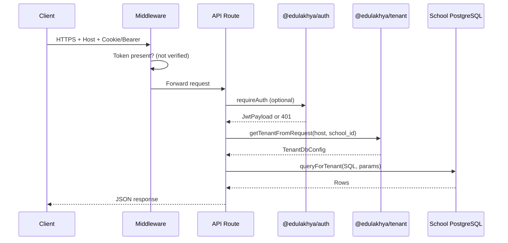

# Edufy Application Audit

**Product:** Shribi School ERP (`edulakhya-monorepo` v2.0.0)  
**Audit date:** July 23, 2026  
**Scope:** Full `edufy` monorepo (primary focus: `apps/super-admin`), related packages, mobile integration via `edufyApp`  
**Method:** Read-only code review — no application code was modified during this audit.

---

## Table of Contents

1. [Executive Summary](#1-executive-summary)
2. [Architecture Overview](#2-architecture-overview)
3. [Authentication & Tenant Session Model](#3-authentication--tenant-session-model)
4. [Academic Session Association with Records](#4-academic-session-association-with-records)
5. [Feature Inventory](#5-feature-inventory)
6. [Broken, Partial, or Risky Functionality](#6-broken-partial-or-risky-functionality)
7. [Security Audit](#7-security-audit)
8. [Data & Schema Management](#8-data--schema-management)
9. [Mobile & Satellite Apps](#9-mobile--satellite-apps)
10. [Recommendations (Prioritized)](#10-recommendations-prioritized)
11. [Key File Reference](#11-key-file-reference)

---

## 1. Executive Summary

Edufy is a **multi-tenant school ERP** built as an npm/Turborepo monorepo. The primary application is **super-admin** (Next.js 14 App Router), which hosts ~328 REST API routes and the full admin UI. Each school gets an **isolated PostgreSQL database**; a separate **control database** stores organizations, tenants (schools/campuses), branding, and platform metadata.

**Strengths:**
- Clear separation of control plane vs tenant (school) data
- Parameterized SQL queries dominate the codebase
- Rich feature surface: students, fees, exams, HR, transport, admissions, exit workflow, alumni, visitors, communications
- JWT carries school/org context; tenant mismatch is checked when a valid JWT is present on a school subdomain

**Critical gaps:**
- **API authentication is inconsistent:** middleware checks token *presence*, not validity; many routes use `getRequestDb()` without `requireAuth()` / `getAuthenticatedDb()`
- **Library module is file-backed JSON**, not tenant DB — breaks multi-tenancy and exit clearance checks
- **Default JWT secret fallback** (`your-secret-key`) if env is unset
- **Several public/unauthenticated endpoints** expose school data or allow school provisioning
- **Academic year/session** is stored on records but not uniformly enforced via a single server-side “active session” context

This document is intended as an audit baseline for remediation planning, penetration testing scope, and onboarding.

---

## 2. Architecture Overview

### 2.1 Monorepo Layout

```
edufy/
├── apps/
│   ├── super-admin/      # Main ERP + API (port 7000) — ~328 API routes
│   ├── parent-portal/    # Parent web portal (7001)
│   ├── transport-admin/  # Transport staff portal (7002)
│   ├── payroll-admin/    # Payroll portal (7003)
│   ├── inventory-admin/  # Inventory portal (7004)
│   ├── teacher-portal/   # Teacher portal (7005, not in PM2 config)
│   └── app-admin/        # Platform operator dashboard (7006)
├── packages/
│   ├── @edulakhya/auth       # JWT, bcrypt, portal login helpers
│   ├── @edulakhya/database   # PostgreSQL pools (default + per-tenant)
│   ├── @edulakhya/tenant     # Control DB, host/subdomain resolution
│   ├── @edulakhya/types      # Shared TypeScript types
│   ├── @edulakhya/ui         # Shared React components
│   └── @edulakhya/utils      # Utilities + CORS for mobile
├── database/
│   ├── schema.sql            # Base school DB bootstrap
│   ├── control_schema.sql    # Control DB schema
│   └── migrations/           # Phase migrations
└── scripts/                  # DB setup, seeding, production bootstrap
```

**Build:** Turborepo (`turbo run dev|build|lint`)  
**Runtime:** Node ≥ 18, PostgreSQL 14+, PM2 (`ecosystem.config.js`) for production

### 2.2 Logical Architecture

```mermaid
flowchart TB
  subgraph clients [Clients]
    Web[Browser - super-admin & portals]
    Mobile[Expo apps - edufyApp]
  end

  subgraph edge [Edge Layer]
    MW[Next.js Middleware]
    Proxy[Reverse proxy / subdomain routing]
  end

  subgraph apps [Next.js Apps]
    SA[super-admin APIs + UI]
    PP[parent-portal]
    Others[transport / payroll / inventory / app-admin]
  end

  subgraph packages [Shared Packages]
    Auth[@edulakhya/auth]
    Tenant[@edulakhya/tenant]
    DB[@edulakhya/database]
  end

  subgraph data [Data Layer]
    ControlDB[(Control DB)]
    SchoolA[(School DB A)]
    SchoolB[(School DB B)]
  end

  Web --> Proxy --> MW --> SA
  Mobile --> Proxy --> SA
  PP --> packages
  SA --> Auth
  SA --> Tenant
  SA --> DB
  Tenant --> ControlDB
  DB --> SchoolA
  DB --> SchoolB
```

### 2.3 super-admin Internal Structure

| Layer | Location | Responsibility |
|-------|----------|----------------|
| Pages | `apps/super-admin/src/app/**/page.tsx` | App Router UI |
| API | `apps/super-admin/src/app/api/**/route.ts` | REST handlers |
| Features | `apps/super-admin/src/features/` | Domain UI modules (students, fees, alumni, etc.) |
| Services / lib | `apps/super-admin/src/lib/` | Business logic, schema ensure-*, request DB |
| Shared UI | `apps/super-admin/src/shared/` | Navigation, contexts, components |
| Middleware | `apps/super-admin/src/middleware.ts` | Auth gate, tenant check, CORS, role routing |

### 2.4 Deployment Model

- One process per app (PM2), ports 7000–7006
- Subdomain routing: `{school-slug}.APP_BASE_DOMAIN` → tenant lookup → school DB
- Org apex host: multi-campus org users select/switch school via JWT `school_id`
- Mobile (`edufyApp`): separate Expo monorepo; Bearer JWT + school API base URL

---

## 3. Authentication & Tenant Session Model

There are **two distinct “session” concepts** in Edufy:

| Concept | What it means | Where it lives |
|---------|---------------|----------------|
| **Auth session (JWT)** | Who is logged in, which school/org they belong to | Cookie `token` or `Authorization: Bearer` |
| **Academic session** | Which academic year (e.g. `2025-26`) records belong to | DB columns + `academic_years` table (see §4) |

This section covers **auth session ↔ tenant ↔ records**.

### 3.1 JWT Payload

Defined in `packages/auth/src/index.ts`:

| Field | Purpose |
|-------|---------|
| `id`, `email`, `role`, `full_name` | Staff user identity |
| `user_type` | `school_local` \| `organization` \| `parent` |
| `organization_id`, `organization_slug` | Org (multi-campus) context |
| `tenant_id` / `school_id` | Active campus (kept in sync) |
| `tenant_slug` / `school_slug` | School slug |
| `accessible_school_ids` | Org user’s allowed campuses |

**Parent JWT** (separate shape in `lib/parent-auth.ts`): `role: 'parent'`, `studentIds[]`, `tenant_id` — no staff `id`.

**Expiry:** 7 days (`JWT_EXPIRY` in auth package).

### 3.1 Login Flows

| Host type | Login behavior |
|-----------|------------------|
| **School subdomain** | Credentials validated against **that school’s DB** (`users` table); JWT includes `school_id` |
| **Organization host** | Requires `school_id` selection; org user from control DB or staff from school DB |
| **Platform / unified login** | Requires `school_code`; resolves org/schools via control DB |

After login, `Set-Cookie: token=...` is applied (`lib/auth-cookie.ts`). Mobile clients typically store the same token and send Bearer header.

**School switch:** `/api/auth/switch-school` re-issues JWT after validating access in control DB (`lib/org-auth.ts` → `buildSchoolSwitchToken()`).

### 3.2 How Auth Session Binds to Database (Tenant Isolation)

Core wiring: `apps/super-admin/src/lib/request-db.ts`

```
Request → resolveAuthFromRequest(JWT) → schoolId, organizationId
        → resolveHostContext(host)     → school subdomain / org host / platform
        → getTenantFromRequest()       → control DB lookup → TenantDbConfig
        → queryForTenant(dbConfig)     → correct school PostgreSQL
```

**Resolution rules:**

1. **School subdomain host** → tenant from subdomain; if JWT has `school_id`, it **must match** host tenant or `TenantResolutionError` is thrown.
2. **Org host + JWT `school_id`** → school validated against org; connects to that school’s DB.
3. **Org host without `school_id`** → control-only (no school DB) or error if token present but no school selected.
4. **Plain localhost / platform** → JWT `school_id` if present; else falls back to env `DB_NAME` (legacy single-tenant dev mode).

**Important:** Tenant isolation is **physical** (separate database per school). There is no `tenant_id` column on most school tables — isolation is by **which DB connection** is used.

### 3.3 How Auth Session Binds to User Actions on Records

| Mechanism | Description |
|-----------|-------------|
| **DB connection scope** | All reads/writes go to the school DB selected by host + JWT |
| **`created_by` / `marked_by` / `uploaded_by`** | Many tables reference `users(id)` for audit (fees, attendance, documents) |
| **Parent APIs** | `requireParentStudentAccess()` scopes by `studentIds` in parent JWT |
| **Role routing (pages)** | `canRoleAccessPath()` in `lib/role-routing.ts` — UI only, not API enforcement |

**Org multi-campus:** JWT includes `accessible_school_ids`, but **`getRequestDb()` does not verify** that the requested `school_id` is in that list (only org membership). Switch-school API validates; direct API calls with a valid JWT for another campus in the same org may succeed for org-wide roles.

### 3.4 Middleware vs API Auth

**Pages (`middleware.ts`):**
- No token → redirect to `/login`
- Role-based path access via **base64 JWT decode** (no signature verification)
- Subdomain validated via internal `/api/tenant/check`

**API routes (`middleware.ts`):**
- Public allowlist → pass through
- Otherwise: **any non-empty token** passes (except super-admin paths check decoded role)
- **Full JWT verification** only when route calls `requireAuth()` or `getAuthenticatedDb()`

**Usage (~328 API route files):**

| Pattern | Approx. count | Verifies JWT signature? |
|---------|---------------|-------------------------|
| `getRequestDb` only | ~237 | No |
| `getAuthenticatedDb` | ~50 | Yes |
| `requireAuth` alone | ~7 | Yes |
| Role helpers (`requireHrAdmin`, etc.) | ~47 | Yes (where used) |

This is the **single largest architectural/security gap**: on a school subdomain, an invalid or forged token can still reach routes that only call `getRequestDb()`, because tenant is resolved from **host alone** when JWT parsing fails or is absent of valid `school_id`.

### 3.5 Session Diagram



---

## 4. Academic Session Association with Records

Academic session = **academic year** (e.g. `2025-26`), not the JWT auth session.

### 4.1 Canonical Sources of “Active” Academic Year

| Source | Table / field | Notes |
|--------|---------------|-------|
| **Primary registry** | `academic_years` (`name`, `start_date`, `end_date`, `is_active`) | Created by `ensure-system-settings.ts` |
| **Denormalized default** | `system_settings.academic_year` | Synced when a year is activated (`syncActiveAcademicYear`) |
| **Query param override** | `?academic_year=` on many APIs | `resolveAcademicYear()` honors explicit param first |
| **Hardcoded fallback** | `'2025-26'` | Used if no settings/active row (`ensure-system-settings.ts`) |

**Activation flow:** POST `/api/academic-years` with `is_active: true` deactivates other years and syncs `system_settings.academic_year`.

### 4.2 Tables Linked to Academic Year

From `database/schema.sql` and `lib/academic-year-usage.ts`:

| Domain | Table(s) | Association column(s) |
|--------|----------|------------------------|
| Classes | `classes` | `academic_year` (VARCHAR) |
| Student placement (historical) | `student_enrollments` | `academic_year`, `academic_year_id`, `is_current` |
| Fees | `fee_structures`, `student_fees`, `fee_payments`, `payment_receipts` | `academic_year` |
| Exams | `exams` | `academic_year` |
| Timetable | `timetable` | `academic_year` |
| Students (current) | `students` | `class_id`, `section_id` (current class; not year column on student row) |

**Enrollment model:** `student_enrollments` is the **session-wise history** table:
- One row per student per academic year (intended)
- `is_current = true` — at most one current enrollment per student (unique partial index)
- Status: `active`, `promoted`, `repeated`, `transferred`, `left`
- Promotions/exit workflows update enrollments and `students.status`

### 4.3 How APIs Resolve Academic Year

Helper: `resolveAcademicYear(db, fromQuery)` in `lib/ensure-system-settings.ts`:

1. Use query string if provided  
2. Else `system_settings.academic_year`  
3. Else `academic_years WHERE is_active = true`  
4. Else default `'2025-26'`

**Implications:**
- **No global server-side “session middleware”** for academic year — each route must call `resolveAcademicYear` or filter explicitly
- UI may show one year while a route without filtering returns all years
- Mixed use of `academic_year` (string) vs `academic_year_id` (integer FK) — both checked in usage queries

### 4.4 Academic Session vs Auth Session (Summary)

| Question | Answer |
|----------|--------|
| Is academic year stored in JWT? | **No** — only in DB and optional query params |
| Can two users in same school see different academic years? | **Yes**, if UI sends different `?academic_year=` or uses local state |
| Is data isolated per academic year automatically? | **No** — requires explicit SQL filters |
| What ties a student to a session? | `student_enrollments.academic_year` + `is_current`; fees/exams/attendance tie via their own year columns or dates |

---

## 5. Feature Inventory

Features below reflect **sidebar navigation** and implemented modules in super-admin. Status is approximate based on code review.

### 5.1 Dashboard & Core

| Feature | Route | Status |
|---------|-------|--------|
| Admin dashboard | `/admin` | Implemented |
| School registration | `/register-school` | Implemented (public) |
| Platform admin | `app-admin` app | Separate app |

### 5.2 Student Management

| Feature | Route | Status |
|---------|-------|--------|
| Admissions / inquiries | `/admissions` | Implemented (DB + ensure schema) |
| Students list & profiles | `/students` | Implemented |
| Bulk edit | `/students/bulk-edit` | Implemented |
| Promotions | `/promotions` | Implemented |
| Transfer certificates | `/students/transfer-certificates` | Implemented |
| Student ID cards | `/students/id-cards` | Implemented |
| Gate pass | `/students/gate-pass` | Implemented |
| Exit students | `/students/exit-students` | Implemented (workflow + clearance) |
| Alumni management | `/students/alumni-management` | Implemented (tabs: directory, higher ed, employment, events, ID card, success stories) |
| Student reports | `/students/reports` | Implemented |

**Alumni eligibility rules:** Only students who **exited** with reason `COMPLETED` (Passed Final Class) from the **highest numeric class** (e.g. Class 12) become alumni (`lib/alumni-eligibility.ts`).

### 5.3 Employee / HR / Payroll

| Feature | Route | Status |
|---------|-------|--------|
| Employee list | `/staff` | Implemented |
| Teachers list | `/academics/teachers` | Implemented |
| Staff ID cards, documents, reports | `/staff/*` | Implemented |
| HR dashboard, departments, designations, shifts | `/hr/*` | Implemented |
| Leave, promotions, increments, resignations | `/hr/*` | Implemented |
| Salary structures, payroll | `/payroll`, `/hr/salary-structures` | Implemented |
| Biometric integration | `/coming-soon?feature=biometric` | **Not built** (schema stubs exist in ensure-hr) |

### 5.4 Attendance

| Feature | Route | Status |
|---------|-------|--------|
| Student register, mark attendance | `/attendance/*` | Implemented |
| Staff attendance | `/attendance/staff/*` | Implemented |
| Reports | `/attendance/reports` | Implemented |

### 5.5 Academics

| Feature | Route | Status |
|---------|-------|--------|
| Classes & sections | `/academics/classes` | Implemented |
| Subjects, houses, assignments | `/academics/*` | Implemented |
| Timetable | `/academics/timetable` | Implemented |
| Syllabus tracking | `/academics/syllabus` | Implemented |
| Academic calendar | `/academics/academic-calendar` | Implemented |
| Homework | `/homework` | Implemented |

### 5.6 Examinations & Results

| Feature | Route | Status |
|---------|-------|--------|
| Exams, marks entry | `/exams` | Implemented |
| Exam analytics | `/exams/analytics` | Implemented |
| Report cards / grades | `/report-cards` | Implemented |
| Rank lists | `/teachers/ranking` | Implemented |
| Marksheet public verify | `/verify` (public API) | Implemented |

### 5.7 Fees & Accounting

| Feature | Route | Status |
|---------|-------|--------|
| Fee dashboard, setup, collect, ledger | `/fees/*` | Implemented |
| Receipts, structures, operations | `/fees/*` | Implemented |
| Fee reminders | `/fees/reminders` | **Placeholder UI** (fake send) |
| Accounting | `/accounting` | Partial — requires phase migration |

### 5.8 Communications

| Feature | Route | Status |
|---------|-------|--------|
| SMS | `/communications?tab=sms` | Implemented (provider-dependent) |
| WhatsApp | `/communications?tab=whatsapp` | **Coming soon** |
| Circulars, email, notifications, history | `/communications` | Partial / env-dependent |
| Event calendar | `/event-calendar` | Implemented |

### 5.9 Transport

| Feature | Route | Status |
|---------|-------|--------|
| Dashboard, vehicles, drivers, routes | `/transport/*` | Implemented |
| Student allocation, assignments | `/transport/*` | Implemented |

### 5.10 Library

| Feature | Route | Status |
|---------|-------|--------|
| Dashboard, books, members, issue/return | `/library/*` | **Partial — JSON file store** |
| Masters (authors, publishers, etc.) | `/library/masters/*` | **Missing sub-pages (404)** |
| Digital, inventory, reports, settings, acquisition | `/library/*` | **Stub pages** |
| Fines | `/library/fines` | Minimal UI |

### 5.11 Inventory & Visitors

| Feature | Route | Status |
|---------|-------|--------|
| School inventory | `/inventory` | Implemented (DB) |
| Visitor management | `/visitor-management` | Implemented |

### 5.12 Settings

| Feature | Route | Status |
|---------|-------|--------|
| School setup, system settings | `/settings`, `/settings/setup` | Implemented |
| User / staff access | `/settings/user-access`, `/settings/staff-access` | Implemented |
| Report & theme settings | `/settings/reports`, `/settings/theme` | Implemented |
| Notification settings | `/settings/notifications` | **Missing page (404)** |

### 5.13 Embedded Portals (within super-admin)

| Portal | Prefix | Status |
|--------|--------|--------|
| Parent | `/parent/*` | Implemented |
| Teacher | `/teacher/*`, `/teachers/*` | Implemented |
| Org | `/org/*` | Implemented |

---

## 6. Broken, Partial, or Risky Functionality

### 6.1 Critical — Data Integrity & Multi-Tenancy

| Issue | Impact | Evidence |
|-------|--------|----------|
| **Library uses shared JSON file** | No tenant isolation; all schools share one `library-data.json`; data loss risk on deploy | `lib/library-store.ts`, `database/library-data.json` |
| **Exit clearance reads JSON library** | Library clearance in exit workflow is unreliable in production | `lib/student-exit-validation.ts` |
| **Library APIs unauthenticated** | Any request with token presence can read/write library data | `/api/library/*` routes use `readStore`/`writeStore` only |

### 6.2 High — Missing Routes (404)

| Path | Linked from |
|------|-------------|
| `/settings/notifications` | Sidebar |
| `/library/masters/authors` | Library masters hub |
| `/library/masters/publishers` | Library masters hub |
| `/library/masters/vendors` | Library masters hub |
| `/library/masters/locations` | Library masters hub |
| `/library/circulation/renew` | Circulation hub |
| `/library/circulation/reservations` | Circulation hub |

### 6.3 High — UI/API Mismatches (Library)

| Issue | Evidence |
|-------|----------|
| Member create drops email/phone/type | UI sends fields; API persists `{ id, name, card_number, active }` only |
| Issue book ignores user-supplied dates | API uses server today + fixed 14-day due |
| Return book ignores fine/remarks/custom date | API only accepts `issue_id` |
| Edit/filter buttons non-functional | `library/members/page.tsx` |
| Photo/cover uploads not persisted | UI collects files; POST payloads omit uploads |

### 6.4 Medium — Placeholders & Stubs

| Feature | Issue |
|---------|-------|
| Fee reminders | `setTimeout` placeholder, no communications API |
| WhatsApp | UI + config API marked coming soon |
| Biometric | Sidebar → coming-soon; HR schema has punch tables unused |
| Library digital/inventory/reports/settings/acquisition | Title-only stub pages |
| Accounting | Error message references manual phase9 migration |

### 6.5 Medium — Schema & Migration Drift

Many modules use **runtime DDL** (`ensure-*-schema.ts`) on first API hit instead of versioned migrations:

- Alumni, student exits, gate passes, visitors, communications, transport, fees extensions, exams engine, timetable, admissions inquiries, etc. are **absent from base `schema.sql`**

**Risks:**
- New tenant DBs depend on first-access code paths to create tables
- Production deploy order matters; rollback is difficult
- `accounting_*` tables not covered by ensure-* — accounting fails without manual migration

### 6.6 Low — Navigation & UX Inconsistencies

| Issue | Detail |
|-------|--------|
| Settings nav mismatch | Sidebar lists Notification Settings; `SettingsNav.tsx` may list different items (e.g. Payment Gateway) |
| Admission number display | Bulk edit fixed; CSV/print export may still show raw prefixed admission numbers |
| Legacy alumni rows | Profiles created before eligibility rules may exist in DB but are hidden from lists |

### 6.7 Auth-Related Functional Gaps

| Issue | Detail |
|-------|--------|
| Parent API cookie vs Bearer | Parent login sets cookie; some parent helpers expect Bearer only |
| Portal staff JWT | `portal-login.ts` omits tenant in token — relies on host |
| Page RBAC bypass | Forged JWT payload can pass middleware role checks (UI only) |

---

## 7. Security Audit

### 7.1 Critical Findings

| ID | Finding | Risk | Location |
|----|---------|------|----------|
| SEC-01 | Middleware accepts **any non-empty token** without signature verification | Forged JWT bypasses API gate on routes using only `getRequestDb` | `middleware.ts` |
| SEC-02 | ~237 API routes use `getRequestDb` without `requireAuth` | Unauthenticated access to school data if host resolves tenant | Various `/api/**/route.ts` |
| SEC-03 | Default JWT secret `'your-secret-key'` | Token forgery if `JWT_SECRET` unset | `packages/auth/src/index.ts` |
| SEC-04 | `/api/parent/get-parent-phone` returns parent PII without parent session check | Privacy violation | `api/parent/get-parent-phone/route.ts` |
| SEC-05 | `/api/platform/schools/register` unauthenticated | Arbitrary school/org provisioning | `api/platform/schools/register/route.ts` |
| SEC-06 | Library module: no auth + shared file | Cross-tenant data leak / tampering | `lib/library-store.ts`, `/api/library/*` |

### 7.2 High Findings

| ID | Finding | Risk | Location |
|----|---------|------|----------|
| SEC-07 | Super-admin setup routes rely on middleware decode-only role check | Privilege escalation with forged token | `/api/settings/initialize-system`, `/api/auth/register`, etc. |
| SEC-08 | `/api/auth/register` accepts arbitrary `role` in body | Creates users with any role if middleware bypassed | `api/auth/register/route.ts` |
| SEC-09 | `accessible_school_ids` not enforced in `getRequestDb` | Org user may access campus outside assigned list | `lib/request-db.ts` |
| SEC-10 | Marksheet verify may leak partial student info on failed match | Information disclosure | `api/marksheets/verify` |

### 7.3 Medium Findings

| ID | Finding | Risk | Location |
|----|---------|------|----------|
| SEC-11 | Page role routing uses unverified JWT decode | UI bypass (defense in depth) | `lib/role-routing.ts`, `middleware.ts` |
| SEC-12 | Public endpoints expose org/school metadata | Reconnaissance | `/api/public/school-code`, `/api/org/schools/public`, `/api/tenant/branding` |
| SEC-13 | Query logging may log SQL + params | Sensitive data in logs | `packages/database/src/index.ts` |
| SEC-14 | Login guard in-memory only | Weak brute-force protection multi-instance | `lib/login-guard.ts` |
| SEC-15 | Legacy default DB fallback on platform host | Wrong-tenant reads in misconfigured env | `getRequestDb()` fallback branch |
| SEC-16 | Duplicate public path allowlists | Config drift between middleware and api-auth | `middleware.ts`, `api-auth.ts` |

### 7.4 Positive Security Patterns

- Widespread use of **parameterized queries** (`$1`, `$2`)
- `getAuthenticatedDb()` properly chains `requireAuth` + tenant resolution
- Tenant **mismatch check** when valid JWT `school_id` ≠ subdomain tenant
- bcrypt password hashing
- Login Turnstile + lockout (when configured)
- School switch re-validates against control DB
- Optional tenant DB password encryption (`TENANT_DB_ENCRYPTION_KEY`)
- CORS allowlist via `CORS_ALLOWED_ORIGINS`

### 7.5 Public API Surface (Intentional — Review Exposure)

| Endpoint | Purpose | Data exposed |
|----------|---------|--------------|
| `POST /api/auth/login` | Authentication | — |
| `GET /api/tenant/check` | Subdomain validation | exists boolean |
| `GET /api/tenant/branding` | School branding | name, logo, contact |
| `GET /api/org/branding` | Org branding | org metadata |
| `GET /api/org/schools/public` | School picker | campus list |
| `GET /api/public/school-code` | Mobile unified login | org + schools |
| `POST /api/platform/schools/register` | Self-service signup | creates tenant |
| `GET /api/platform/schools/check-slug` | Slug availability | boolean |
| `GET /api/marksheets/verify` | Public marksheet check | student/exam summary |

### 7.6 RBAC Model (Current State)

- **Page-level:** role → allowed path prefixes (`role-routing.ts`)
- **API-level:** ad hoc — `requireSuperAdmin`, `requireHrAdmin`, `hasRole()` on some routes
- **No centralized permission matrix** — most routes assume any authenticated staff role
- **`packages/rbac/`** is essentially a stub

**Roles observed:** `super_admin`, `admin`, `administrator`, `teacher`, `parent`, `transport_manager`, `inventory_manager`, `org_owner`, `org_admin`, `org_viewer`

---

## 8. Data & Schema Management

### 8.1 Two-Tier Database

| Database | Contents |
|----------|----------|
| **Control DB** | `organizations`, `tenants`, `tenant_branding`, `organization_users`, subscriptions, platform admins |
| **School DB** (one per tenant) | Students, staff, fees, attendance, exams, HR, transport, inventory, etc. |

### 8.2 Schema Provisioning Paths

1. **Bootstrap:** `database/schema.sql` on school DB creation  
2. **Phase migrations:** `scripts/migrate.js`, `database/migrations/`  
3. **Runtime ensure-*:** First API call runs DDL (alumni, exits, visitors, fees extensions, …)  
4. **Prebuild sync:** `scripts/sync-database-sql.js` copies schema into super-admin

### 8.3 Student Lifecycle Data Model

```
students (current class, status)
    └── student_enrollments (per academic year, is_current)
    └── student_exits (exit workflow — runtime schema)
    └── alumni_profiles (eligible exits only — runtime schema)
```

**Status values:** `active`, `inactive`, `graduated`, `transferred` on `students`; exit workflow sets these on completion.

---

## 9. Mobile & Satellite Apps

### 9.1 edufyApp (Expo — sibling repo)

- Apps: parent, teacher, management, student, transport, visitor
- Auth: Bearer JWT in AsyncStorage
- APIs: Same super-admin routes (`/api/parent/*`, `/api/teacher/*`, etc.)
- School resolution: `/api/public/school-code` on apex domain

### 9.2 Satellite Next.js Apps

Thin portals sharing packages; most business logic remains in super-admin. Production PM2 runs 6 apps (teacher-portal excluded from `ecosystem.config.js`).

---

## 10. Recommendations (Prioritized)

### P0 — Immediate (Security & Data Integrity)

1. **Remove JWT secret fallback** — fail startup if `JWT_SECRET` missing  
2. **Enforce JWT verification on all non-public API routes** — migrate to `getAuthenticatedDb()` or add shared wrapper  
3. **Replace library JSON store** with tenant-scoped PostgreSQL tables + auth  
4. **Remove or protect** `/api/parent/get-parent-phone` (parent auth + student scope)  
5. **Rate-limit / CAPTCHA / admin approval** on `/api/platform/schools/register`

### P1 — Short Term

6. Add `requireSuperAdmin()` inside setup/register routes (not middleware-only)  
7. Enforce `accessible_school_ids` in `getRequestDb()` for org users  
8. Consolidate public path allowlists into one module  
9. Create missing pages (notifications, library masters sub-routes) or remove sidebar links  
10. Wire fee reminders to communications API; remove placeholder  

### P2 — Medium Term

11. Migrate all `ensure-*` DDL to versioned migrations; include alumni, exits, library, accounting  
12. Standardize academic year filtering — optional middleware or shared `withAcademicYear()` helper  
13. Implement proper RBAC package or permission table  
14. Align parent auth: support cookie + Bearer consistently  
15. Reduce SQL logging in production  

### P3 — Long Term

16. Complete library module (circulation fines, renewals, digital assets)  
17. WhatsApp + biometric integrations  
18. Central audit log for sensitive actions  
19. Automated security tests (auth bypass, tenant isolation)  

---

## 11. Key File Reference

| Area | Path |
|------|------|
| Request → tenant DB | `apps/super-admin/src/lib/request-db.ts` |
| API auth helpers | `apps/super-admin/src/lib/api-auth.ts` |
| Middleware | `apps/super-admin/src/middleware.ts` |
| JWT auth package | `packages/auth/src/index.ts` |
| Tenant / control DB | `packages/tenant/src/index.ts` |
| DB pools | `packages/database/src/index.ts` |
| Academic year resolution | `apps/super-admin/src/lib/ensure-system-settings.ts` |
| Academic year usage | `apps/super-admin/src/lib/academic-year-usage.ts` |
| Base schema | `database/schema.sql` |
| Sidebar / features | `apps/super-admin/src/shared/navigation/sidebar-navigation.ts` |
| Library file store | `apps/super-admin/src/lib/library-store.ts` |
| Alumni eligibility | `apps/super-admin/src/lib/alumni-eligibility.ts` |
| Student exit workflow | `apps/super-admin/src/lib/student-exit-service.ts` |
| Login | `apps/super-admin/src/app/api/auth/login/route.ts` |
| Role routing | `apps/super-admin/src/lib/role-routing.ts` |

---

## Appendix A — Audit Limitations

- This audit is **static code review** — no penetration testing or runtime exploitation was performed  
- Route counts are approximate (~328 API files)  
- Satellite apps (`parent-portal`, etc.) were not exhaustively reviewed; they likely inherit the same auth patterns  
- Mobile app (`edufyApp`) was not source-reviewed in this pass; integration points are documented from super-admin side  

---

## Appendix B — Glossary

| Term | Meaning |
|------|---------|
| **Tenant** | A school/campus with its own PostgreSQL database |
| **Organization** | Group/trust owning one or more tenants |
| **Control DB** | Registry of orgs, tenants, branding, org users |
| **Auth session** | JWT identifying logged-in user and active school |
| **Academic session** | Academic year (e.g. 2025-26) tied to enrollments and fees |
| **ensure-* schema** | Runtime idempotent DDL executed on first module access |

---

*End of audit document.*
